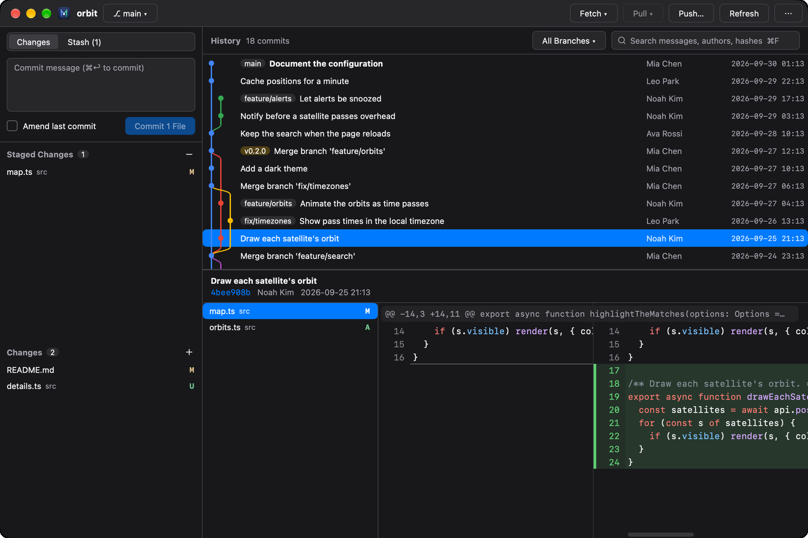
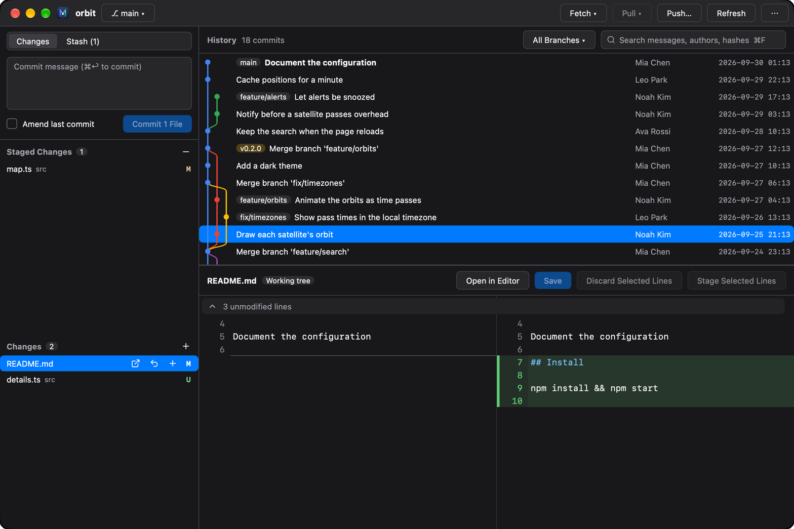
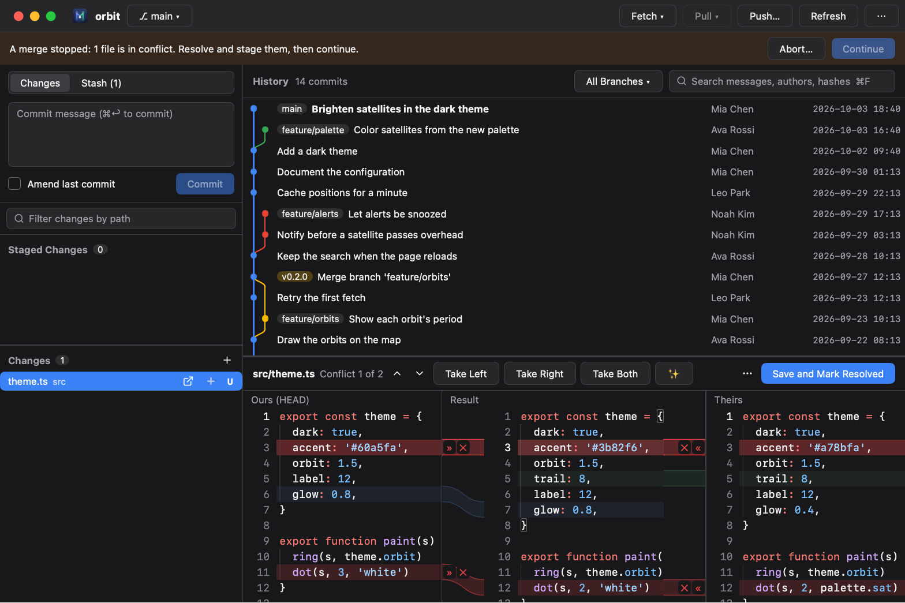
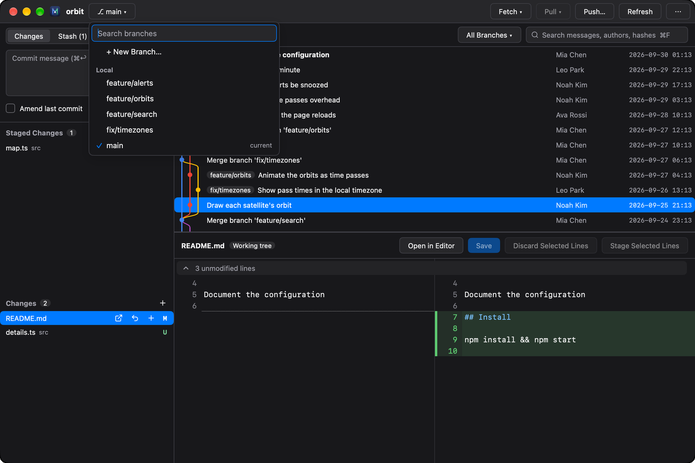
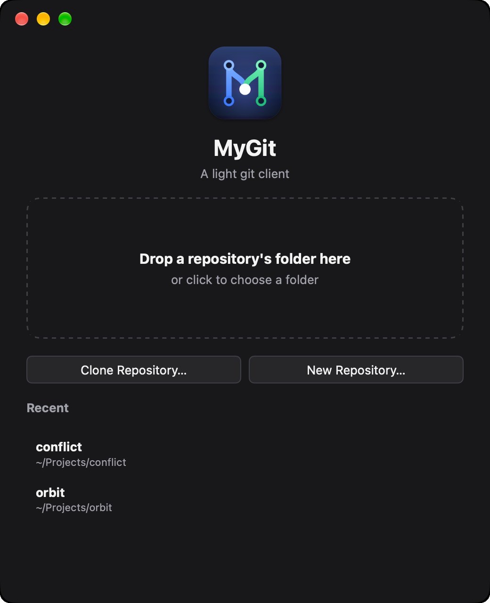

<p align="center">
  
</p>

<h1 align="center">MyGit</h1>

<p align="center">
  A light, fast git client with a native UI.<br>
  JetBrains' commit graph and history tools, VS Code's way of staging, in a sixth of the memory.
</p>

<p align="center">
  <a href="https://github.com/Binaryify/MyGit/actions/workflows/ci.yml"></a>
  
  
  
  
</p>

<p align="center">
  <b>English</b> · <a href="README.zh-CN.md">简体中文</a>
</p>

<p align="center">
  
</p>

<p align="center">
  <a href="site/assets/mygit-demo-en.mp4"><b>▶ Watch the 40-second demo</b></a>
</p>

## Why MyGit

Standalone git clients built on an IDE platform carry the IDE with them. MyGit is a single native binary drawn on the GPU by [MyGo](https://github.com/egoist/mygo): no webview, no JVM.

| On a repository of 20,000 commits | MyGit | Rebased (IntelliJ platform) |
|---|---|---|
| Memory once open | **109 MB** | 806 MB |
| Reading the whole history and laying out its graph | **0.13 s** | — |
| Opening a commit with a 20 MB patch (5,677 files) | **0.24 s** | — |
| CPU while idle | **0 %** | — |

MyGit reads what `git` prints and lets `git` itself make every change, so a repository behaves in MyGit exactly as it does in a terminal.

## Why not Sourcetree?

Sourcetree is free and mature, but it isn't what MyGit is after:

| | MyGit | Sourcetree |
|---|---|---|
| Linux | **Yes** | No — macOS and Windows only |
| One app on every platform | **Yes**, the same code and features | Separate macOS and Windows apps that differ |
| Resolving a conflict | **Built in**: ours, result and theirs side by side, a conflict at a time | Take a whole side, or hand off to an external merge tool |
| Fixing a line in the diff before staging it | **Yes** | No |

## Features

<table>
  <tr>
    <td width="50%"></td>
    <td width="50%"></td>
  </tr>
  <tr>
    <td><b>Stage what you mean.</b> Stage files, changes or single lines, and edit the working tree right in the diff.</td>
    <td><b>Resolve conflicts side by side.</b> Ours, the result and theirs, a conflict at a time.</td>
  </tr>
  <tr>
    <td></td>
    <td></td>
  </tr>
  <tr>
    <td><b>Find any branch.</b> Search local and remote branches, switch, merge, rebase or compare.</td>
    <td><b>Open anything.</b> Drop a folder, clone, or pick a recent repository.</td>
  </tr>
</table>

- **History** — every branch, tag and remote with its graph, streamed as it loads; search by message, author or hash; filter by branch or path (file history)
- **Commits** — whole messages, changed files and side-by-side diffs with syntax highlighting; a merge against any parent; compare two commits (⌘-click), a branch or the working tree
- **Staging** — stage, unstage or discard files, changes or selected lines; edit and save the working tree in the diff
- **History tools** — branch, tag, check out, cherry-pick, revert, reset (soft / mixed / hard) and interactive rebase (reorder, reword, edit, squash, fixup, drop)
- **Reviewing** — generated files (lockfiles, minified, `linguist-generated`) fold away; mark files viewed; changed pictures show before and after; comment on lines and copy the comments as Markdown for an agent or a colleague
- **Pull requests** — open a GitHub pull request, read and reply to its threads under their lines, resolve them, and submit a review: comment, approve or request changes
- **Conflicts** — a three-pane merge view, and continue, skip or abort a merge, rebase, cherry-pick or revert
- **Stash, blame and remotes** — stash with untracked files, blame a file line by line, manage remotes, pull (fast-forward, rebase or merge), preview a push, force with lease
- **Sign-ins** — when git needs a username, token or passphrase, the window asks
- **Everywhere** — a window per repository, drag folders in, `mygit .` from a terminal, custom title bars, light and dark, English and 简体中文, signed auto-updates

## Install

Releases are coming soon. Until then, build it from source with [Go](https://go.dev/dl/) 1.27 or later:

```bash
git clone https://github.com/Binaryify/MyGit.git
cd MyGit
go tool mygo build    # build/darwin-arm64/MyGit.app, and the disk image
```

MyGit needs `git` on the `PATH`. It runs on macOS (Apple silicon), Windows (x64) and Linux (x64); Intel Macs aren't supported.

## Shortcuts

| Keys | Does |
|---|---|
| ⌘↩ / Ctrl+Enter | Commit |
| ⌘F / Ctrl+F | Search the history |
| ⌘R / Ctrl+R | Refresh |
| ⌘P / Ctrl+P | Go to a file of the commit or the changes |
| ⌘K / Ctrl+K | Commands |
| ⌘S / Ctrl+S | Save the file edited in the diff |
| Space | Stage or unstage the change chosen; mark a commit's file viewed |
| Delete | Discard the change chosen |
| ⌘-click | Compare two commits |

## Development

```bash
go tool mygo dev      # run, reloading on changes
go test ./...         # the tests, the UI's included, need no window
go tool mygo build -platform darwin/arm64,windows/amd64,linux/amd64
```

The texts live in [`locales/`](locales): `en.json` is the source and `zh-Hans.json` its Chinese. After changing them, run `go tool mygo generate`. Translations into other languages are welcome: add `locales/<tag>.json`.

To release, describe the version in [`CHANGELOG.md`](CHANGELOG.md) and push a tag such as `v0.2.0`: CI signs the updates with the `MYGO_UPDATER_PRIVATE_KEY` secret, builds the macOS disk image, the Windows installer and zip, and the Linux package, and publishes them in a release.

Benchmarks: `MYGIT_BENCH_REPO=<repo> MYGIT_BENCH_COMMIT=<commit> go test -run '^$' -bench .`
