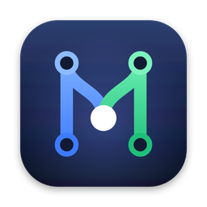
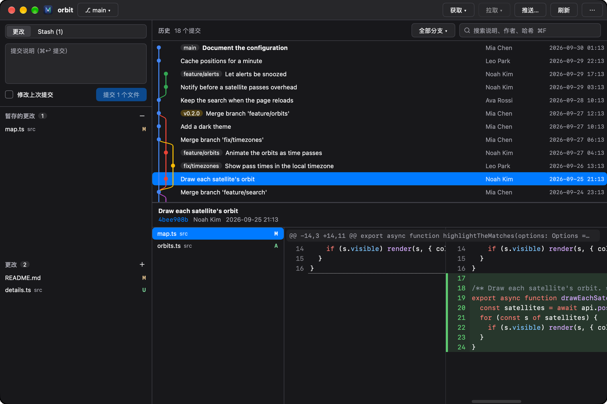
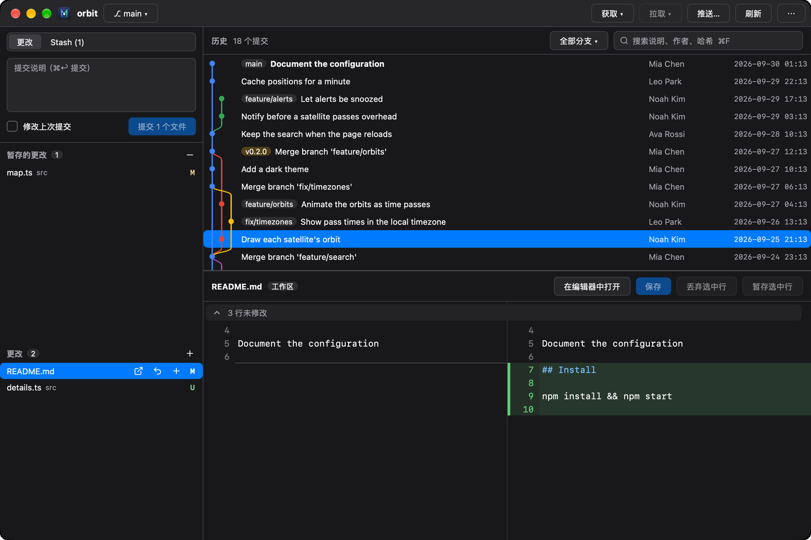
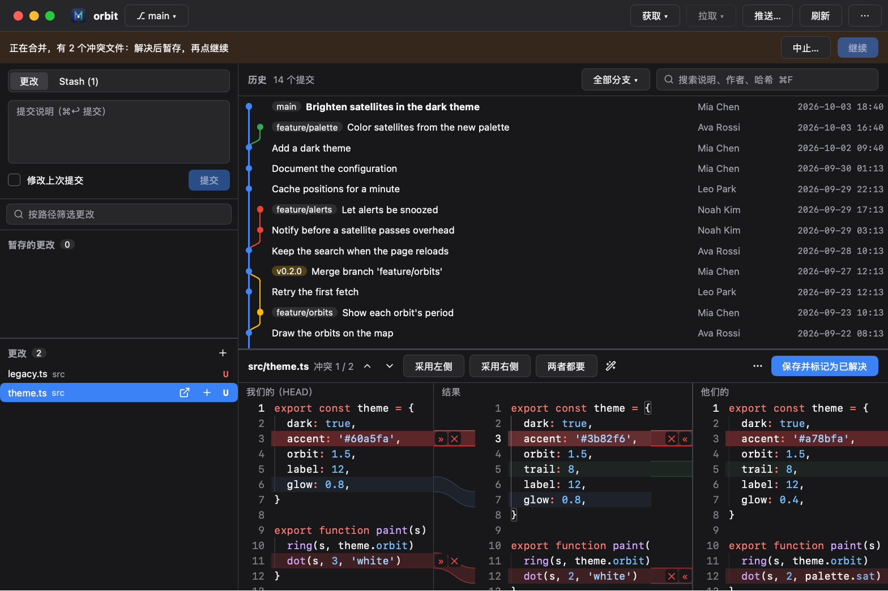
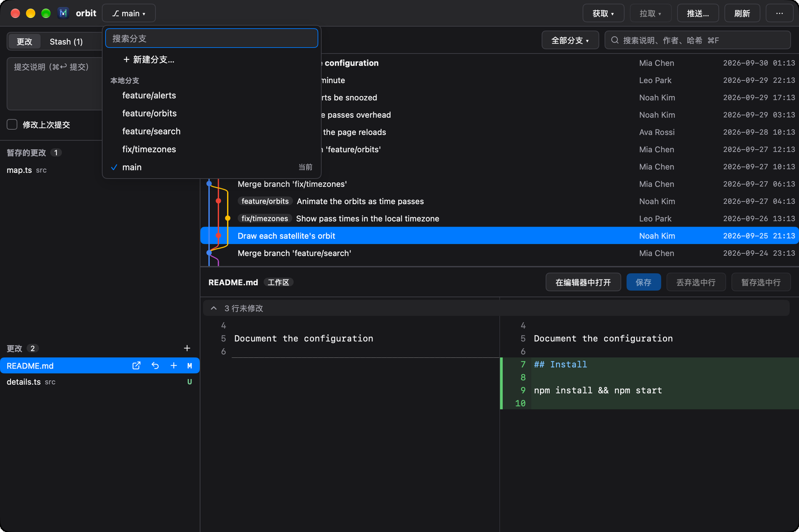
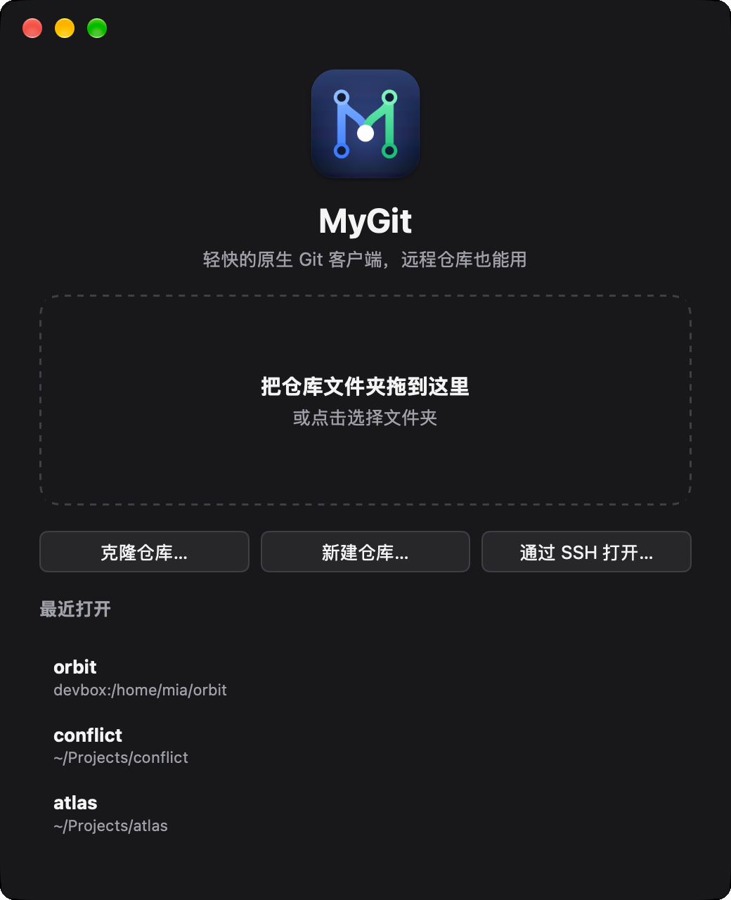

<p align="center">
  
</p>

<h1 align="center">MyGit</h1>

<p align="center">
  <b>快速查看 agent 的改动</b><br>
  在终端里敲 <code>mygit .</code> 就能打开，文件一改马上能看到，没问题的一键暂存，不用等 IDE 启动。<br>
  轻量、快速、现代的 git 客户端：JetBrains 的分支图和历史操作，VS Code 的暂存方式，内存却只要它们的零头。
</p>

<p align="center">
  <a href="https://github.com/Binaryify/MyGit/actions/workflows/ci.yml"></a>
  
  
  
  
</p>

<p align="center">
  <a href="https://binaryify.com/mygit/">官网</a> · <a href="README.md">English</a> · <b>简体中文</b>
</p>

<p align="center">
  
</p>

<p align="center">
  <a href="site/assets/mygit-demo-zh.mp4"><b>▶ 观看演示视频</b></a>
</p>

## 为什么是 MyGit

代码交给 agent 写以后，用 git 的大部分时间都花在看改了什么上。MyGit 让这件事变快：

1. **看**：文件一改，这里马上就能看到，不用手动刷新。每个文件并排对比、带语法高亮。锁文件、压缩文件和生成的文件自动折叠，图片改动显示前后对比。
2. **留**：直接在 diff 里修一行，把没问题的文件、改动块或行暂存起来，然后提交。
3. **退**：在要返工的行上写一句，复制为 Markdown（每条带文件、行号和代码），粘给 Claude Code、Codex 或同事。

MyGit 读的是仓库，不是某个 agent 的会话，所以换哪个 agent、同时用几个、还是你自己改的代码，用起来都一样。

| 现在看 agent 改动的办法 | 换成 MyGit |
|---|---|
| agent 自带的 diff 视图 | 哪个 agent 都能用，还能逐行暂存，提交前直接改代码 |
| 打开 IDE | 秒开，内存只要零头 |
| 终端里跑 `git diff` | 并排对比，生成文件自动折叠，文件一改马上能看到 |

### 轻量、快速、现代

用起来就是你熟悉的 IDE：JetBrains 的分支图和历史操作，VS Code 的改动列表和暂存方式，⌘K 打开命令栏，⌘P 转到文件，深浅色都有。但它不是 IDE：MyGit 是一个原生二进制文件，由 [MyGo](https://github.com/egoist/mygo) 用 GPU 绘制界面，没有 webview，也没有 JVM。打开一个 2 万个提交的仓库后的内存占用，应用的所有进程都计算在内（Apple M4）：

| 应用 | 内存 |
|---|---|
| **MyGit** | **109 MB** |
| 精简版 IntelliJ 客户端 | 750 MB |
| VS Code，不带插件 | 1000 MB |
| VS Code，167 个插件 | 1400 MB |
| IntelliJ IDEA 2026.2 | 2300 MB |

在同一个仓库上，MyGit 读完全部历史并布局分支图只要 **0.13 秒**，打开一个 20 MB 补丁的提交（5677 个文件）只要 **0.24 秒**，空闲时 CPU 为 **0%**。

MyGit 读取靠解析 `git` 的输出，所有改动都交给 `git` 命令本身完成，所以仓库在 MyGit 里的表现和在终端里完全一致。macOS、Windows 和 Linux 上是同一个应用，功能完全相同。

## 功能

<table>
  <tr>
    <td width="50%"></td>
    <td width="50%"></td>
  </tr>
  <tr>
    <td><b>想暂存什么就暂存什么。</b>按文件、按改动块、按行暂存，还能直接在 diff 里编辑工作区文件。</td>
    <td><b>三栏解决冲突。</b>我们的、结果、他们的，一个冲突一个冲突地处理。</td>
  </tr>
  <tr>
    <td></td>
    <td></td>
  </tr>
  <tr>
    <td><b>任何分支都能找到。</b>搜索本地和远程分支，切换、合并、变基或比较。</td>
    <td><b>怎么打开都行。</b>拖入文件夹、克隆，或者从最近打开里选。</td>
  </tr>
</table>

- **看改动**：生成的文件（锁文件、压缩文件、`linguist-generated`）默认折叠；可以把文件标记为已看；图片改动显示前后对比；可以评论某几行，并把评论复制为 Markdown 交给 AI 或同事
- **暂存**：按文件、改动块或选中的行暂存、取消暂存、丢弃；在 diff 里编辑并保存工作区文件
- **提交**：完整说明、改动文件、带语法高亮的并排 diff；合并提交可以选对比哪个父提交；比较两个提交（⌘ 点选）、分支或工作区
- **历史**：所有分支、标签、远程，带分支图，边读边显示；按说明、作者、哈希搜索；按分支或路径筛选（文件历史）
- **历史操作**：新建分支和标签、检出、cherry-pick、revert、reset（soft / mixed / hard）、交互式变基（重排、改写说明、停下修改、squash、fixup、丢弃）
- **拉取请求**：打开 GitHub 拉取请求，在对应行下阅读和回复讨论、解决讨论，并提交审阅：评论、批准或请求修改
- **冲突**：三栏合并视图；合并、变基、cherry-pick、revert 中途可以继续、跳过或中止
- **Stash、Blame 和远程**：stash（可包括未跟踪文件）、逐行追溯、远程管理、拉取（快进 / 变基 / 合并）、推送前预览、force-with-lease
- **登录**：git 需要用户名、令牌或口令时，在窗口里询问
- **随处可用**：每个仓库一个窗口、拖入文件夹打开、终端里 `mygit .`、自定义标题栏、深浅色、English 和简体中文、签名的自动更新

## 安装

下载最新版本：

| 平台 | 下载 |
|---|---|
| macOS（Apple 芯片） | [MyGit-macos-arm64.dmg](https://github.com/Binaryify/MyGit/releases/latest/download/MyGit-macos-arm64.dmg) |
| Windows（x64） | [安装程序](https://github.com/Binaryify/MyGit/releases/latest/download/MyGit-windows-amd64-setup.exe) · [zip](https://github.com/Binaryify/MyGit/releases/latest/download/MyGit-windows-amd64.zip) |
| Linux（x64） | [.deb](https://github.com/Binaryify/MyGit/releases/latest/download/MyGit-linux-amd64.deb)，或用下面的脚本 |

Linux 上这条命令把 MyGit 装到 `~/.local`，不需要 root：

```bash
curl -fsSL https://github.com/Binaryify/MyGit/releases/latest/download/install.sh | sh
```

MyGit 暂未经过 Apple 公证。如果 macOS 提示无法打开，先把它拖进「应用程序」，再运行：

```bash
xattr -dr com.apple.quarantine /Applications/MyGit.app
```

Windows 安装程序暂时也没有代码签名。如果 Windows 提示「已保护你的电脑」，点「更多信息」，再点「仍要运行」。

MyGit 需要 `PATH` 里有 `git`，安装后会自动更新。不支持 Intel Mac。所有版本见 [Releases 页面](https://github.com/Binaryify/MyGit/releases)。

想从源码构建，见[开发](#开发)。

## 快捷键

| 按键 | 作用 |
|---|---|
| ⌘↩ / Ctrl+Enter | 提交 |
| ⌘F / Ctrl+F | 搜索历史 |
| ⌘R / Ctrl+R | 刷新 |
| ⌘P / Ctrl+P | 转到提交或更改里的文件 |
| ⌘K / Ctrl+K | 命令栏 |
| ⌘S / Ctrl+S | 保存在 diff 里编辑的文件 |
| 空格 | 暂存或取消暂存选中的改动；把提交里的文件标记为已看 |
| Delete | 丢弃选中的改动 |
| ⌘ 点选 | 比较两个提交 |

## 开发

```bash
git clone https://github.com/Binaryify/MyGit.git && cd MyGit   # 需要 Go 1.27 或更新版本
go tool mygo dev      # 运行，改动后自动重新加载
go test ./...         # 测试，界面测试也不需要窗口
go tool mygo build -platform darwin/arm64,windows/amd64,linux/amd64
```

界面文字在 [`locales/`](locales) 里：`en.json` 是源语言，`zh-Hans.json` 是简体中文，改完运行 `go tool mygo generate`。欢迎贡献其他语言的翻译：新增 `locales/<语言标签>.json` 即可。

发布：在 [`CHANGELOG.md`](CHANGELOG.md) 写好这个版本的说明（会成为 Release 的说明，缺了发布会失败），再推送 `v0.2.0` 这样的标签。CI 会用仓库 Secret `MYGO_UPDATER_PRIVATE_KEY` 给更新包签名，打包 macOS 磁盘镜像、Windows 安装程序和 zip、Linux 安装包，并创建 Release。签名私钥在本机 `~/Library/Application Support/mygo/update-keys/mygit/`，丢失后已安装的应用就收不到更新了。仓库是私有的时候，已安装的应用下载不到 Release 里的更新包，测试自动更新前要先把仓库公开，或者把更新包放到公开地址。

基准测试：`MYGIT_BENCH_REPO=<仓库> MYGIT_BENCH_COMMIT=<提交> go test -run '^$' -bench .`

## 许可证

[MIT](LICENSE)
